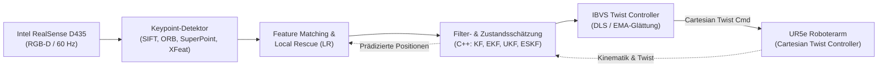

# Modellbasierte Keypoint-Filterung für robustes Image-Based Visual Servoing (MoKeF)

[-008080.svg?logo=latex&logoColor=white)](#kompilierung--build-anleitung)
[](#systemarchitektur--softwarekomponenten)
[-3A68AA.svg)](#projektdaten--autoren)
[](#projektdaten--autoren)

Dieses Repository enthält den vollständigen LaTeX-Quellcode, Abbildungen, Auswertungsskripte und die Dokumentation für das Forschungs- und Entwicklungsprojekt (F&E-Projekt) an der **Hochschule Karlsruhe (HKA)** im Masterstudiengang der Fakultät für Maschinenbau und Mechatronik.

---

## Inhaltsverzeichnis

- [Überblick & Motivation](#überblick--motivation)
- [Projektdaten & Autoren](#projektdaten--autoren)
- [Systemarchitektur & Softwarekomponenten](#systemarchitektur--softwarekomponenten)
- [Methodischer Ansatz & Kernbeiträge](#methodischer-ansatz--kernbeiträge)
- [Benchmarking & Experimentelles Setup](#benchmarking--experimentelles-setup)
- [Repository-Struktur](#repository-struktur)
- [Kompilierung & Build-Anleitung](#kompilierung--build-anleitung)
  - [Voraussetzungen](#voraussetzungen)
  - [Kompilierung über CLI (latexmk / pdflatex)](#kompilierung-über-cli-latexmk--pdflatex)
  - [Konvertierung von PGF-Grafiken (Matplotlib zu SVG)](#konvertierung-von-pgf-grafiken-matplotlib-zu-svg)
- [Verwendete LaTeX-Pakete & Typografie](#verwendete-latex-pakete--typografie)
- [Literatur & Referenzen](#literatur--referenzen)

---

## Überblick & Motivation

In der industriellen Robotik erfordert die Handhabung metallischer, spiegelnder oder schwach texturierter Bauteile eine robuste visuelle Führung. Klassisches **Image-Based Visual Servoing (IBVS)** stößt unter realen Fabrikbedingungen häufig an Grenzen:
- **Starke Reflexionen & Specular Highlights** auf spiegelnden Werkstücken führen zum plötzlichen Abreißen von Feature-Tracks.
- **Temporäre Verdeckungen (Okklusionen)** durch Greifer, Werkzeuge oder Hindernisse unterbrechen die kontinuierliche Fehlerberechnung.
- **Rasche Beleuchtungswechsel** verursachen instabile Feature-Zuordnungen (Matching Outliers) und führen zu Reglerschwingungen.

Dieses Projekt adressiert die Herausforderung durch eine **hybride, modellgestützte Architektur**: Reale Bildfeatures aus einem Kamerasystem (Intel RealSense D435) werden mit einer prädiktiven, kinematikbasierten Keypoint-Simulation gekoppelt. Zustandsfilter (u.&thinsp;a. **KF, EKF, UKF, ESKF und 1€-Filter**) schätzen die Feature-Trajektorien prädiktiv voraus. Geht ein Feature verloren, ermöglicht eine **Local-Rescue-Strategie** die gezielte lokale Wiedererkennung, wodurch die visuelle Regelung auch bei massiven Störungen stabil bleibt.



---

## Projektdaten & Autoren

| Eigenschaft | Details |
| :--- | :--- |
| **Projekt** | Forschungs- und Entwicklungsprojekt (F&E), Wintersemester 2025/2026 |
| **Titel** | Modellbasierte Keypoint-Filterung für robustes Image-Based Visual Servoing |
| **Kurztitel** | Model Filter IBVS |
| **Hochschule** | Hochschule Karlsruhe (HKA) – University of Applied Sciences |
| **Fakultät** | Fakultät für Maschinenbau und Mechatronik (MMT) |
| **Autoren** | **Paul Glaser, B.&thinsp;Eng.** (glpa1013 / Matrikelnr. 100215)<br/>**Tim Schäfer, B.&thinsp;Eng.** (scti1057 / Matrikelnr. 71606)<br/>**Felix Wietschel, B.&thinsp;Eng.** (wife1013 / Matrikelnr. 74940) |
| **Erstprüfer** | Prof. Dr.-Ing. Christian Friedrich |
| **Zweitprüfer** | Prof. Dr.-Ing. Frank Pöhler |
| **Betreuer** | Dominik Werman, M.&thinsp;Sc. |
| **Abgabedatum** | 31. März 2026 |

---

## Systemarchitektur & Softwarekomponenten

Die zugrundeliegende Software ist modular in **ROS 2** implementiert und in Docker containerisiert. Sie unterteilt sich in folgende Pakete:

1. **`ibvs_msgs`**: 
   Benutzerdefinierte ROS-2-Nachrichtendefinitionen (`Keypoints`, `Matches`, Filter- und Diagnosedaten) als standardisierte Schnittstelle aller Nodes.
2. **`ibvs_perception` (Python)**: 
   Visuelle Wahrnehmung (`keypoint_node.py`). Extraktion von Bildmerkmalen mittels klassischer (ORB, SIFT) und moderner DNN-basierter Detektoren (SuperPoint, XFeat), inklusive tiefenbasierter Region-of-Interest (ROI)-Maskierung.
3. **`ibvs_reference` (Python)**: 
   Referenzmanagement (`reference_manager_node.py`). Erzeugt während der Initialisierung aus einer Mehrbildsequenz eine konsolidierte, rauschresistente Referenzdatenbank (Cosinus-Ähnlichkeit & Spatial Gating).
4. **`ibvs_matching` (Python)**: 
   Korrespondenzsuche zwischen aktuellen Beobachtungen und Referenzfeatures. Beinhaltet Prefilterung und den modellgestützten **Local-Rescue (LR)**-Algorithmus zur Wiederfindung temporär verlorener Features.
5. **`ibvs_filter_cpp` (C++)**: 
   Echtzeitfähige C++-Zustandsschätzung (`filter_node`). Projiziert Robotergeschwindigkeiten über TF in den Kameraframe, prädiziert Merkmalsbewegungen und fusioniert sie über Kalman-Filter-Varianten (**KF, EKF, UKF, ESKF**).
6. **`ibvs_control` (Python)**: 
   Regelungsknoten (`ibvs_twist_controller_node.py`). Ermittelt Bildfehler bezüglich der Referenz, berechnet die Interaktionsmatrix (Bild-Jacobi-Matrix), stabilisiert die Invertierung per Damped Least Squares (DLS) und publiziert kartesische Twist-Befehle an den Roboter.

---

## Methodischer Ansatz & Kernbeiträge

- **Multi-Frame Referenzdatenbank**: Robuster Aufbau des Soll-Zustands über Zeitfenster statt fehleranfälliger Einzel-Snapshots.
- **Kinematische Prädiktion im Kamera-Frame**: Transformation der Roboterbewegung via TF-Baum in den Bildraum zur kontinuierlichen Vorhersage der Keypoint-Trajektorien.
- **Top-Down Feedback & Local Rescue**: Rückkopplungsschleife von der Zustandsschätzung in das Matching: Verlorene Keypoints werden in einem begrenzten Suchfenster um die prädizierte Lage re-identifiziert.
- **Umfassender Filtervergleich**: Empirische Gegenüberstellung von Standard-KF, Extended Kalman Filter (EKF), Unscented Kalman Filter (UKF), Error-State Kalman Filter (ESKF) sowie heuristischen Glättungsfiltern (1€-Filter).

---

## Benchmarking & Experimentelles Setup

Die Evaluierung basiert auf einem fünfdimensionalen Versuchsraum zur Quantifizierung von Robustheit, Stabilität und Regelgüte:

| Dimension | Ausprägungen |
| :--- | :--- |
| **1. Verarbeitungsstufen** | • Baseline (reines Feature-Matching ohne Filter)<br/>• Zustandsfilterung (Tracking / Glättung)<br/>• Zustandsfilterung mit integriertem **Local Rescue (LR)** |
| **2. Filter-Algorithmen** | • Kalman-Filter (KF)<br/>• Extended Kalman-Filter (EKF)<br/>• Unscented Kalman-Filter (UKF)<br/>• Error-State Kalman-Filter (ESKF)<br/>• 1€-Filter |
| **3. Stör-Szenarien** | • **Szenario I (Standard):** Nominale Umgebungsbedingungen<br/>• **Szenario II (Okklusion):** Gezielte Verdeckung über 3D-gedruckte Schablonen/Brücken<br/>• **Szenario III (Lichtwechsel/Reflexion):** Dynamische Punktlichtquellen, Glanzeffekte, Specular Highlights |
| **4. Freiheitsgrade (DoF)** | • **Level a (4-DoF):** Translation $x, y, z$ + Rotation $\gamma$ (z-Achse)<br/>• **Level b (6-DoF):** Volle räumliche Bewegung in allen 6 Freiheitsgraden |
| **5. Testobjekte** | • **Typ 1:** Texturiert, diffus (z.&thinsp;B. bedrucktes Papier/Muster)<br/>• **Typ 2:** Texturiert, spiegelnd (z.&thinsp;B. bestückte Leiterplatte/Mainboard)<br/>• **Typ 3:** Schwach texturiert, metallisch glänzend (z.&thinsp;B. Aluminium-Fräsbauteil) |

---

## Repository-Struktur

```text
GG_LaTeX_FuE/
├── thesis.tex                     # LaTeX-Hauptdokument (scrreprt, Präambel, Einbindungen)
├── bibliography.bib               # BibTeX-Literaturdatenbank
├── convert_pgf_to_svg.sh          # Hilfsskript zur Batch-Konvertierung von PGF nach SVG
├── 25ws_CF_ModelFilterIBVS_Bericht.pdf # Kompiliertes Abschlussdokument
│
├── TeXFiles/                      # Modulare Kapitel & Konfigurationen
│   ├── 000_Settings.tex           # Metadaten (Autoren, Titel, Betreuer, Farben, Abstände)
│   ├── 001_Titlepage.tex          # HKA-konformes Titelblatt
│   ├── 002_NDNotice.tex           # Sperrvermerk (optional konfigurierbar)
│   ├── 004_Acronyms.tex           # Abkürzungsverzeichnis (acronym-Paket)
│   ├── 005_Glossar.tex            # Glossareinträge (glossaries-Paket)
│   ├── 010_Einleitung.tex         # Motivation, Problemstellung, Zielsetzung
│   ├── 020_Grundlagen.tex         # IBVS, Bildverarbeitung, Geometrie & Kinematik
│   ├── 025_Filtermethoden.tex     # Zustandsschätzung (KF, EKF, UKF, ESKF, 1€-Filter)
│   ├── 030_VerwandteArbeiten.tex  # Stand der Wissenschaft und Technik
│   ├── 040_Systemübersicht.tex    # Gesamtsystem, Hardware (UR5e, D435), ROS-2-Topologie
│   ├── 050_KeypointDatenbank.tex  # Referenzbildung, Feature-Extraktion & Matching
│   ├── 060_ModellbasierteKeypointSimulation.tex # Kinematische Feature-Prädiktion
│   ├── 070_FilterundEntscheidungslogik.tex      # Filterintegration & Outlier-Rejection
│   ├── 080_FeatureConfidenceundSwitchingStrategie.tex # Konfidenzmetriken & Local Rescue
│   ├── 090_RegelungdesRoboterarms.tex # Interaktionsmatrix, DLS, Geschwindigkeitsregelung
│   ├── 091_Softwareimplementierung.tex# ROS-2-Nodes, C++-Filter, Interfaces, Topic-Flow
│   ├── 092_Experimente.tex        # Versuchsaufbau, Testmatrix, Evaluierungsmetriken
│   ├── 093_Ergebnisse.tex         # Auswertung (Trajektorien, RMS-Fehler, Konvergenz)
│   ├── 094_Diskussion.tex         # Kritische Einordnung & Performance-Vergleich
│   ├── 095_FazitundAusblick.tex   # Zusammenfassung & zukünftige Forschungsarbeiten
│   ├── 110_Anhang.tex             # Ergänzende Messreihen, Tabellen, Konfigurationsdaten
│   └── 120_Declaration.tex        # Eidesstattliche Erklärung
│
└── Figures/                       # Abbildungen, Plots & Diagramme
    ├── pgf/                       # Matplotlib-Exporte im PGF-Format (Vektorgrafiken)
    ├── svg/                       # SVG-Vektorgrafiken
    ├── png/                       # Fotos von Versuchsaufbau, Testbauteilen & Screenshots
    ├── tikz/                      # Quellcode nativer TikZ-Ablaufdiagramme
    └── tikz2pdf/                  # Vorkompilierte TikZ-PDFs
```

---

## Kompilierung & Build-Anleitung

### Voraussetzungen

Zur Erstellung des Dokuments wird eine moderne TeX-Distribution (z.&thinsp;B. **MacTeX 2023+** unter macOS oder **TeX Live** unter Linux) benötigt.

Erforderliche CLI-Tools:
- `pdflatex`
- `bibtex`
- `makeglossaries` (Bestandteil von TeX Live)
- Optional: `pdf2svg` (zur Ausführung von `convert_pgf_to_svg.sh`)

Unter macOS via Homebrew:
```bash
brew install --cask mactex-no-gui
brew install pdf2svg
```

### Kompilierung über CLI (latexmk / pdflatex)

#### Methode A: Automatisiert mit `latexmk` (Empfohlen)
`latexmk` löst Abhängigkeiten, BibTeX und Glossar-Läufe automatisch auf:
```bash
latexmk -pdf -synctex=1 -interaction=nonstopmode thesis.tex
```
Zum Bereinigen der temporären Hilfsdateien:
```bash
latexmk -c
```

#### Methode B: Manueller Kompilierungszyklus
```bash
# 1. Erster TeX-Durchlauf
pdflatex -interaction=nonstopmode thesis.tex

# 2. Literaturverzeichnis & Glossar kompilieren
bibtex thesis
makeglossaries thesis

# 3. Querverweise auflösen (zweifach)
pdflatex -interaction=nonstopmode thesis.tex
pdflatex -interaction=nonstopmode thesis.tex
```

Das fertige Dokument liegt anschließend als `thesis.pdf` vor.

### Konvertierung von PGF-Grafiken (Matplotlib zu SVG)

Für die Konvertierung von aus Python/Matplotlib exportierten `.pgf`-Plots in universelle SVG-Vektorgrafiken steht das Skript `convert_pgf_to_svg.sh` zur Verfügung:

```bash
# Ausführungsrechte vergeben
chmod +x convert_pgf_to_svg.sh

# Skript im Verzeichnis der PGF-Dateien aufrufen:
./convert_pgf_to_svg.sh Figures/pgf
```
Das Skript nutzt ein Standalone-LaTeX-Template und generiert die SVGs im Ordner `Figures/svg/`.

---

## Verwendete LaTeX-Pakete & Typografie

- **Dokumentenklasse**: KOMA-Script `scrreprt` (A4, 12pt, einseitig).
- **Schriftbild**: Carlito (`carlito`-Paket) zur barrierefreien, serifenlosen Darstellung (Calibri-Metrik) mit T1-Encoding.
- **Corporate Identity**: An das Farbprofil der Hochschule Karlsruhe (HKA) angepasste Titelfarben (`HKA_MMTblue`, RGB `58, 104, 170`).
- **Mathematik & Einheiten**: `amsmath`, `mathtools`, `amssymb` sowie `siunitx` für typografisch korrekte physikalische Einheiten.
- **Vektorgrafiken**: Native Einbindung via `pgfplots`, `tikz` (mit Custom-Blockdiagramm-Styles) und `svg`.
- **Verzeichnisse & Referenzen**: `natbib` (`unsrtnat`) für zitierreihenfolge-basierte Zitationen sowie `acronym` für die standardisierte Nomenklatur.

---

## Literatur & Referenzen

Die Literaturangaben befinden sich in `bibliography.bib` und umfassen Veröffentlichungen zu:
- Grundlagen des Visual Servoing (*Chaumette, Hutchinson et al.*)
- Roboterregelung & Kinematik des Universal Robots UR5e
- Detektions- und Matchingverfahren (*Lowe, Rublee, DeTone, Sarlin*)
- Zustandsschätzung und Sensorfusion in Robotikanwendungen (*Kalman, Julier, Sola*)

---

*Forschungs- und Entwicklungsprojekt Wintersemester 2025/2026 – Hochschule Karlsruhe (HKA)*

